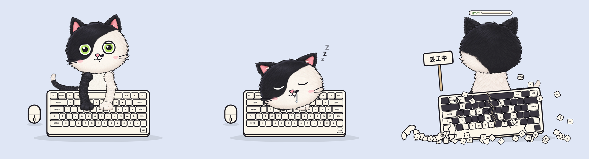

# 捣蛋猫 SillyCat

一只蹲在桌面角落的奶牛猫，跟着你打字，你摸鱼它睡觉，你加班太久它就砸键盘、摔鼠标、罢工。

开源免费，macOS / Windows。

## 下载安装

到本仓库的 [Releases 页面](../../releases/latest)下载安装包。

- macOS 下载 `SillyCat_x.y.z_universal.dmg`，Intel 和 Apple 芯片通用。
- Windows 下载 `SillyCat_x.y.z_x64-setup.exe`。

应用没有正式签名。

- **macOS** 第一次打开被拦时，到「系统设置 → 隐私与安全性」点「仍要打开」。然后到「系统设置 → 隐私与安全性 → 输入监控」打开 SillyCat。没授权时，猫看不到你打字，会冒出气泡「我看不到你打字 / 点这里处理」。
- **Windows** 弹出 SmartScreen 时，点「更多信息 → 仍要运行」。不需要额外授权。

## 它会干什么

- 跟着你打字。你按哪个键，哪个键名就会飘起来。
- 鼠标归尾巴管。你移动或点击鼠标时，尾巴会跟着操作。
- 按住身体可以把猫拖到别处，按住头可以摸头。
- 停一会儿不打字、不点鼠标，猫会先犯困，再睡着、流口水，最后随机用两种姿势之一趴在键盘上。光晃鼠标叫不醒它，按键、点鼠标或摸头才会醒。醒来脸上还留着键盘印。
- 一直打字，猫会越来越烦，开始叹气、变得生气，最后砸键盘、摔鼠标，转过身罢工。
- 罢工时要停手休息。按键或点鼠标会让消气重新计时，只移动鼠标不会打断，摸头时休息时间算双倍。消气后，猫会自己修好键盘和鼠标。
- 头顶的状态条会显示「困了」「烦躁」或「消气中」的进度。

## 设置

右键猫，或点击菜单栏（Windows 系统托盘）图标，选择「设置…」。

| 时间设置 | 默认值 | 可填范围 |
| --- | --- | --- |
| 入睡时间 | 20 秒 | 5–3600 秒 |
| 开始流口水 | 留空自动，入睡时间的 2 倍 | 6–10800 秒 |
| 趴到键盘上 | 留空自动，入睡时间的 3.5 倍 | 7–10800 秒 |
| 连续打字多久发飙 | 90 秒 | 15–36000 秒 |
| 罢工后歇多久消气 | 20 秒 | 5–3600 秒 |

流口水和趴下都从最后一次操作算起，时间必须按入睡、流口水、趴下的顺序递增。「显示状态条」默认开启，可以关掉。

设置里还能调「猫的大小」，范围为 50%–200%，默认 100%，改大小时猫的右下角不动。

菜单栏或托盘图标还可以显示或隐藏猫、重置位置、打开输入监控设置（仅 macOS）和退出应用。

## 隐私

SillyCat 只读取按键位置和鼠标事件来驱动动画，不记录或保存输入，也不联网。macOS 使用只读 CGEventTap，Windows 使用低级键鼠钩子。

## 常见问题

- **macOS 输入监控开着，猫还是不跟着打字。** 换过版本后，授权可能还绑在旧版本的签名上。在 SillyCat 的设置窗口点「重置授权」，然后在输入监控列表里重新打开 SillyCat。系统提示「退出并重新打开」时点它。若没有提示，或列表里找不到 SillyCat，就在设置窗口点「重新启动 SillyCat」。
- **其他应用全屏时找不到猫。** 全屏时猫可能不显示。
- **在密码框里打字，猫没反应。** 系统不会把这些按键交给监听，已经按住的键可能卡在按下状态。
- **Windows 下只在某些窗口里不跟着打字。** 猫收不到以管理员身份运行的窗口里的按键。

## 接下来想做

以下功能还没做。

- 把桌上的东西推下去。
- 鼠标指针一晃就扑过去。
- 饭点找你要吃的。
- 半夜突然跑酷。

## 从源码运行

- 网页版运行 `npm start`，然后打开 <http://localhost:4317/>。
- 桌面版先运行 `npm install`，再运行 `npm run desktop`。打包用 `npm run desktop:build`。

更多见[开发说明](docs/DEVELOPMENT.md)。

## 许可

[MIT](LICENSE)
