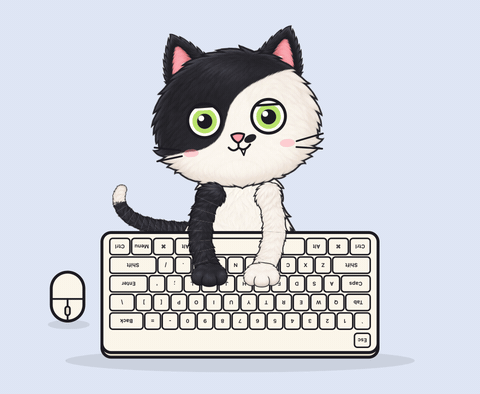
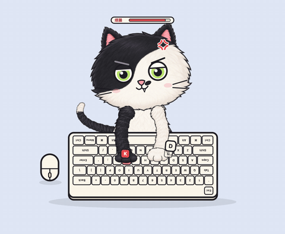
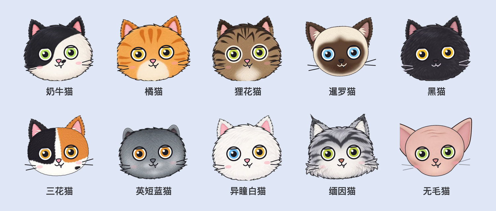

# 捣蛋猫 SillyCat

一只蹲在桌面角落的奶牛猫，跟着你打字，你摸鱼它睡觉，你加班太久它就砸键盘、摔鼠标、罢工。可以在十只猫之间切换：奶牛猫、橘猫、狸花猫、暹罗猫、黑猫、三花猫、英短蓝猫、异瞳白猫、缅因猫和无毛猫。

开源免费，macOS / Windows。

## 下载安装

到本仓库的 [Releases 页面](../../releases/latest)下载安装包。

- macOS 下载 `SillyCat_x.y.z_universal.dmg`，Intel 和 Apple 芯片通用。
- Windows 下载 `SillyCat_x.y.z_x64-setup.exe`。
- Windows 7、8、8.1 下载 `SillyCat_x.y.z_win7_x64-setup.exe`，并先装好 WebView2 109（见下面的常见问题）。它是单独构建的包，更新也只会更新到同一类的包。

应用没有正式签名。

- **macOS** 第一次打开被拦时，到「系统设置 → 隐私与安全性」点「仍要打开」。然后到「系统设置 → 隐私与安全性 → 输入监控」打开 SillyCat。没授权时，猫看不到你打字，会冒出气泡「我看不到你打字 / 点这里处理」。
- **Windows** 弹出 SmartScreen 时，点「更多信息 → 仍要运行」。不需要额外授权。

## 它会干什么

功能按加入的版本分组，越往下越新。

**原版自带**（继承自 S0u1/silly-cat）

- 跟着你打字。你按哪个键，哪个键名就会飘起来。
- 鼠标归尾巴管。你移动或点击鼠标时，尾巴会跟着操作。
- 醒着时，眼睛会跟着鼠标指针看，指针停下几秒后收回目光。
- 醒着时，你刚停下打字，猫偶尔会把桌上的杯子推下去，60 秒后杯子回来。
- 按住身体可以把猫拖到别处，按住头可以摸头。勾选「锁定位置」后，猫拖不动，摸头照常。
- 停一会儿不打字、不点鼠标，猫会先犯困，再睡着、流口水，最后随机用两种姿势之一趴在键盘上。光晃鼠标叫不醒它，按键、点鼠标或摸头才会醒。醒来脸上还留着键盘印。
- 一直打字，猫会越来越烦，开始叹气、变得生气，最后砸键盘、摔鼠标，转过身罢工。罢工时要停手休息，按键或点鼠标会让消气重新计时，只移动鼠标不会打断，摸头时休息时间算双倍。消气后，猫会自己修好键盘和鼠标。
- 头顶的状态条会显示「困了」「烦躁」或「消气中」的进度。
- 猫一直浮在其他窗口上面。macOS 上切换桌面，或别的应用进入全屏时，猫也会跟过去。

**0.0.7 · 第一次扩展**（2026-11）

- 你停下手的工夫它也不闲着：偶尔伸个懒腰、打个哈欠，或者舔爪子洗脸；还会偷偷够桌上的咖啡喝，被你打断就心虚地缩手。
- 桌角摆着三张快捷方式小卡片，你发呆时猫会把它们拍得团团转，偶尔推下桌沿，过一会儿又悄悄摆回来。
- 快速甩鼠标，猫会压低身子扑上去，抱着鼠标玩一会儿再得意地放开。
- 饭点（中午 11–13 点、傍晚 17–19 点）桌上会摆出一盆猫粮，你一闲下来它就伸爪敲碗催你喂饭。
- 深夜（23 点到清晨 6 点）你闲着时，猫可能突然来回冲刺跑酷一圈，睡着自己也会跳起来跑。
- 趴着睡太久会掉毛：键盘上落下猫毛，身上也粘几撮，醒活动活动就掉了。
- 打出 cat、mao、miao、meow，猫会抬头找你，「喵！」一声。
- 连戳猫几下它会烦，挥爪拍开你的手；拉它尾巴会挨一记回眸哈气，它还更烦躁了。
- 摸头攒好感度：每摸一秒涨一点，头顶冒爱心；攒够 60，它会在你发呆时趴下来踩奶。连戳和拉尾巴会掉好感。

**0.0.9 · 一起玩**（2026-11）

- 按住 F 不放，会垂下来一个晃来晃去的毛线球，猫伸爪拍着玩，拍够三下开心打滚、涨好感。
- 你闲着的时候偶尔会掉下来一个红点，猫瞳孔放大扑过去追，扑空两次就甩尾巴生气，扑到了开心地涨好感。
- 快速连按两下 G，抛进来一颗小鱼干，猫跳起来空中接住吃掉；2 分钟里喂超过 3 颗它会嫌多，把鱼扒拉到一边。
- 你打字飞快时猫看得眼都圆了，「好快！」；连狂敲 10 秒它捂住耳朵喊「耳朵要炸了！」，收手后松口气。
- 睡着后会冒梦话小气泡，身子跟着轻轻扭；刚说完梦话被吵醒会无辜地「喵？」。
- 你发呆时偶尔冒一句精神状态不太稳定的语录，也会随节日换装：万圣节摆南瓜灯、圣诞节戴圣诞帽、春节围红围巾、情人节飘爱心、生日（设置里可填）全程爱心眼。
- 连续工作满 1 小时没歇，猫举起「起来动动！」的牌子催你休息；继续打字它举得更高，摸摸头表示知道了。
- 每隔一阵猫会把一杯水推到你面前盯着你——「该喝水了」，摸摸头表示喝过了；晾着不理它就自己收回去，但提前再来。
- 设置里开启番茄钟后，猫陪你按 25 分钟专注 + 5 分钟休息的节奏工作，每 4 个番茄休一次长的，左上角挂着倒计时，切换时铃铛响。

**1.0.0 · 正式版**（2026-11-25）

- 连按两下 Esc，猫立刻趴下装睡（摸鱼老板键）；再按两下秒醒。连按两下 P，把猫此刻的表情截成透明底图片，直接粘贴发群。
- 好感度攒到 30 送小红围巾、攒到 90 送小皇冠，戴上就不摘。
- 你发呆时，偶尔有一只小奶猫从屏幕边爬进来，坐在旁边待一会儿再原路爬走，大猫会盯着它看。
- 修复：逗猫棒的毛线球松开 F 后不消失；同一台电脑重复启动会开出多只猫；设置里「关于」的链接点错。

**1.1.0 · 小奶猫重做**（2026-11-25）

- 小奶猫串门全面重做：从画面左边走进来——四条腿对角步态、身体一颠一颠、尾巴摇摆——跳上键盘走到中间伸个懒腰，趴下打个小盹（呼吸起伏、偶尔眨眼），几秒后起身从画面右边走出去。大猫全程盯着它看、还打呼噜。
- 它趴着的时候你一打字会吓到它，随机两种结局：被大猫一巴掌拍飞出画面（大猫抬起两只爪中随机一只，扬起来拍下去再自动收回，小猫转圈飞出，「啪！！喵嗷——！」），或者它自己爬起来慌忙跑掉。
- 小奶猫串门的冷却从 3–6 分钟延长到 30–60 分钟。
- 检查更新支持国内双源：GitHub 连不上自动切换 Gitee 兜底，再失败才提示手动下载；发版时安装包自动同步到 Gitee Release。
- 修复：换过猫或画风后红围巾消失（好感度 30+ 的桌面版用户受影响，皇冠不受影响）；番茄时钟红点挡住倒计时首位数字。

## 设置

右键猫，或点击菜单栏（Windows 系统托盘）图标，选择「设置…」。

在设置最上面的「换只猫」点头像，猫会马上换成选中的那只，下次启动也会记住。
旁边的「画风」可以在默认的「毛绒」和原来的「线条」之间切换。猫和头像会马上换画风，下次启动也会记住。

| 时间设置 | 默认值 | 可填范围 |
| --- | --- | --- |
| 入睡时间 | 20 秒 | 5–3600 秒 |
| 开始流口水 | 留空自动，入睡时间的 2 倍 | 6–10800 秒 |
| 趴到键盘上 | 留空自动，入睡时间的 3.5 倍 | 7–10800 秒 |
| 连续打字多久发飙 | 90 秒 | 15–36000 秒 |
| 罢工后歇多久消气 | 20 秒 | 5–3600 秒 |

流口水和趴下都从最后一次操作算起，时间必须按入睡、流口水、趴下的顺序递增。「显示状态条」默认开启，可以关掉。

可以关掉「推东西」，或改大约多久推一次（默认 600 秒）。

<<<<<<< HEAD
「音效」默认开启：喵叫、踩奶的呼噜、砸键盘、敲碗声都是现场合成的，不需要联网，不想要就关掉。

「番茄钟」默认关闭：开启后猫按 25 + 5（每 4 个番茄后 15 分钟）的节奏陪你工作，画面左上角显示倒计时。「猫的生日」可以填一个「月-日」（比如 3-15），那天猫会全程爱心眼给你庆祝。

设置里还有两个记号本：「小账本」记着累计按键次数、发飙次数和推杯次数，可以一键清零；「好感度」记着你和猫的感情（摸头涨、连戳和拉尾巴掉），攒够 60 它就会踩奶，也可以清零。
=======
「眼睛跟着鼠标」默认开启，可以关掉。
>>>>>>> origin/main

设置里还能调「猫的大小」，范围为 50%–200%，默认 100%。拖动时猫会实时变大变小，右下角不动。

「自动检查更新」默认开启，启动后和之后每天各检查一次新版本。有新版本时，猫旁边会冒出「有新版本」气泡，点它就会下载、校验并安装，装好后自动重启。下载失败时可以点「重试」。关掉这一项后，仍可以从菜单里点「检查更新…」手动检查。

「开机时自动启动」默认关闭，打开后可在系统的登录项或启动项里看到。

右键猫和点击菜单栏（Windows 系统托盘）图标打开的是同一套菜单。还可以检查更新、显示或隐藏猫、锁定位置、重置位置、打开输入监控设置（仅 macOS）和退出应用。锁定状态下次启动也会记住。锁定后仍可用「重置位置」把猫放回默认位置，锁定状态保持不变。

## 隐私

SillyCat 只读取按键位置和鼠标事件来驱动动画。「小账本」「好感度」也只在本机存几个数字（按了多少次、发了多少次飙），不记录按键内容，不上传任何数据。桌面版默认只访问 GitHub 上本项目的 Release 检查新版本，点击更新后才下载并安装。在「设置…」里关闭「自动检查更新」即可停止后台联网，仍可从右键菜单或托盘菜单手动检查。macOS 使用只读 CGEventTap，Windows 使用低级键鼠钩子。

## 常见问题

- **macOS 升级后，或输入监控明明开着，猫还是不跟着打字。** 授权可能还绑在旧版本的签名上。在 SillyCat 的设置窗口点「重置授权」，然后在「系统设置 → 隐私与安全性 → 输入监控」里重新打开 SillyCat。系统提示「退出并重新打开」时点它。若没有提示，或列表里找不到 SillyCat，就在设置窗口点「重新启动 SillyCat」。从第一个用固定证书签名的版本起，只需要这样重新授权一次，之后升级不用再重置。
- **在密码框里打字，猫没反应。** 系统不会把这些按键交给监听。离开密码框后，猫会自己恢复正常。
- **Windows 下只在某些窗口里不跟着打字。** 猫收不到以管理员身份运行的窗口里的按键。
- **Windows 安装时提示「无法下载 WebView2」或「无法安装 WebView2」。** SillyCat 需要微软的 WebView2 运行库。系统里没有时，安装程序会联网到微软服务器下载，下载失败就会报这个错。请先手动安装：打开[微软 WebView2 下载页](https://developer.microsoft.com/microsoft-edge/webview2/)，在 Evergreen Standalone Installer 一栏选 x64 下载并运行（也可以直接用[这个下载直链](https://go.microsoft.com/fwlink/?linkid=2124701)，约 280MB，是完整的离线安装包），装好后再重新运行 SillyCat 的安装程序。Windows 7、8、8.1 请看下一条。
- **Windows 7、8、8.1 上装 WebView2 失败，提示「无法定位程序输入点 PackageIdFromFullName」。** 微软最新版的 WebView2 已经不支持这几个系统，上一条的下载页和直链给的是最新版，在这里会报这个错。请改装微软为这几个系统保留的最后一版 109：[下载 WebView2 109.0.1518.140（x64，150,552,536 字节，微软更新目录提供）](https://catalog.s.download.windowsupdate.com/c/msdownload/update/software/updt/2023/09/microsoftedgestandaloneinstallerx64_1c890b4b8dd6b7c93da98ebdc08ecdc5e30e50cb.exe)，下载后运行，装好再运行 SillyCat 的安装程序。文件的 SHA-256 是 `eac95c8095ec5f9971eade9827d8fb67fd251f5c16e702b5312d31067e39119b`，可用来核对。链接失效或系统是 32 位时，打开 [Microsoft Update Catalog](https://www.catalog.update.microsoft.com/Search.aspx?q=webview2%20runtime%20109)，选「Microsoft Edge-WebView2 Runtime Version 109 Update」中对应系统位数（x64 或 x86）的最新一项下载。

## 接下来想做

以下功能还没做。

- ~~鼠标指针一晃就扑过去。~~ 已实现：快速甩鼠标，猫会扑上去抱住。
- ~~饭点找你要吃的。~~ 已实现：饭点摆出猫粮盆，你一闲下来它就敲碗。
- ~~半夜突然跑酷。~~ 已实现：深夜随机来回冲刺，睡着自己也会跳起来跑。

暂时没有新的排队项，欢迎提想法。

## 从源码运行

- 网页版运行 `npm start`，然后打开 <http://localhost:4317/>。
- 桌面版先运行 `npm install`，再运行 `npm run desktop`。本地普通安装包和带更新签名的发布包分别按[开发说明](docs/DEVELOPMENT.md#更新机制)构建。

更多见[开发说明](docs/DEVELOPMENT.md)。

## 许可

[MIT](LICENSE)

## 致谢

本项目基于 [S0u1/silly-cat](https://github.com/S0u1/silly-cat)（MIT 许可）修改扩展，新增了扑鼠标、饭点敲碗、深夜跑酷、好感度等玩法，感谢原作者。本仓库的修改部分同样按 MIT 许可发布。
